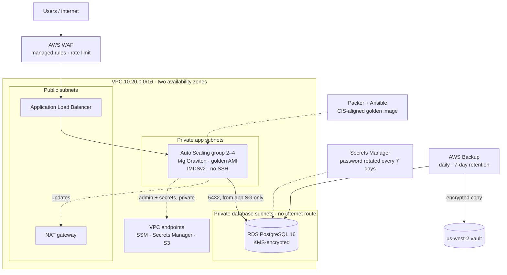
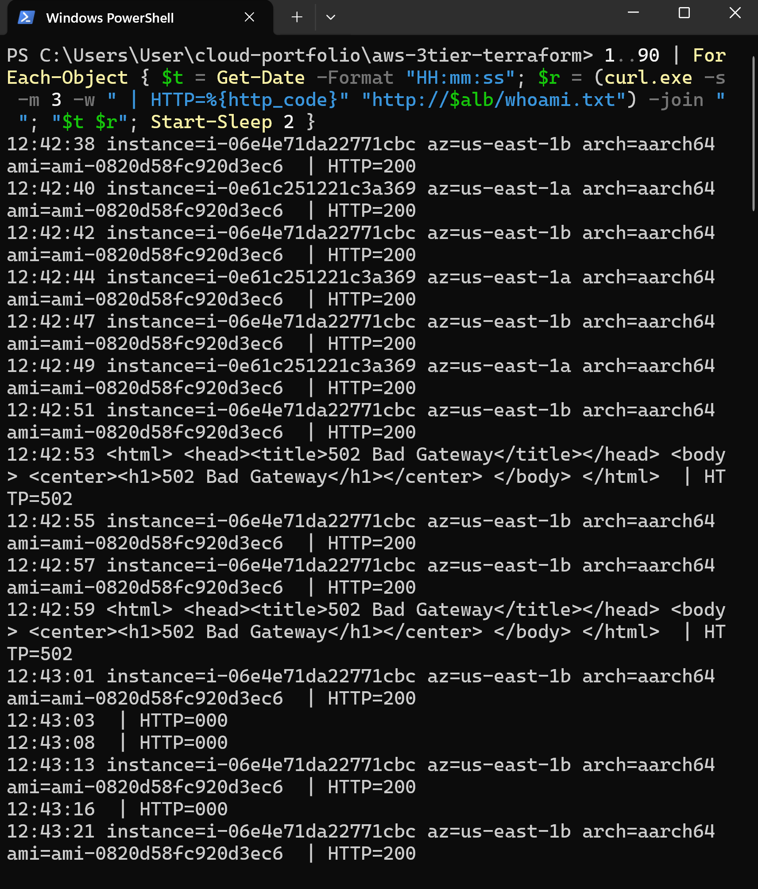
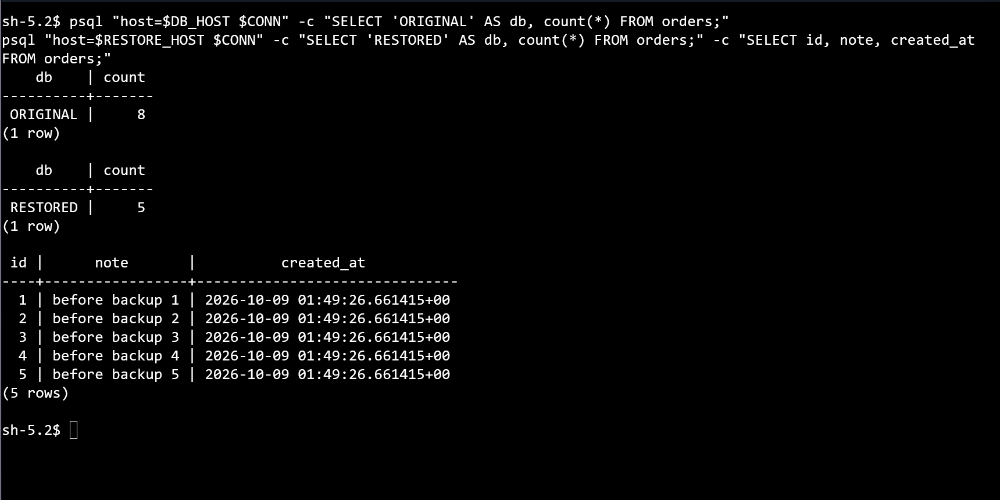
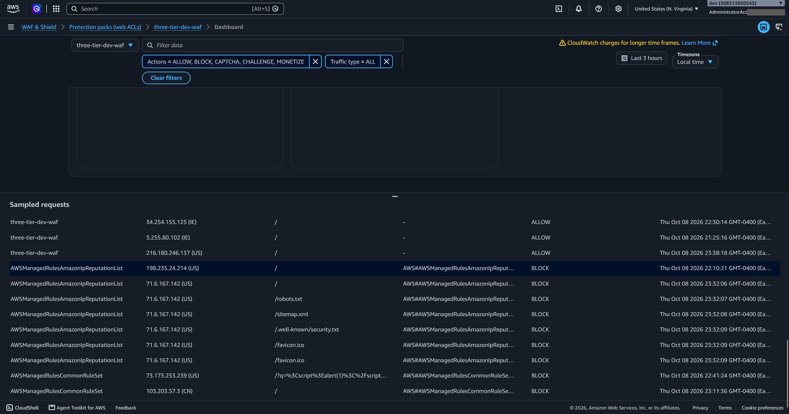

# Highly Available 3-Tier AWS Architecture (Terraform)

A production-style web application stack on AWS, built entirely with Terraform modules and tested under failure: multi-AZ networking, an Application Load Balancer behind AWS WAF, an Auto Scaling group of hardened Graviton servers launched from a Packer golden image, and an encrypted PostgreSQL database with managed secrets and cross-region backups.

Every claim below is backed by a test and a screenshot, including **measured** failover, scaling, and restore times.

**Skills shown:** VPC design · ALB · Auto Scaling · RDS · KMS · Secrets Manager · VPC endpoints · AWS WAF · AWS Backup · Packer · Ansible · SSM Session Manager · Graviton · Terraform modules · disaster recovery testing

This builds on my [secure landing zone](https://github.com/ike-barnes/aws-secure-landing-zone): it runs in the `dev` account, provisioned through IAM Identity Center with no long-lived access keys.

---

## Results at a glance

| What was tested | Measured result |
|---|---|
| Server terminated under live traffic | About 25 s of partial errors (other AZ kept serving), replacement serving in about 2 min 45 s |
| CPU load on both servers | Scaled 2 → 4 instances automatically, then back to 2 when load stopped |
| SQL injection, XSS, Log4j payloads | All blocked with 403 at the edge; normal traffic 200 |
| Real internet scanners | Blocked by WAF IP reputation within hours of going live |
| Database backup | About 4 minutes; scheduled backup ran on its own at 05:00 UTC |
| Cross-region copy | Completed to us-west-2, encrypted with a regional KMS key |
| Database restore | **16 min 48 s**; restored 5 of 8 rows, proving the RPO |

---

## Architecture



---

## What's built

| Layer | What it does | Code |
|---|---|---|
| Network | VPC with public, app, and database subnet tiers across 2 AZs; NAT gateway; S3 gateway and interface endpoints | [`modules/vpc`](modules/vpc) |
| Web tier | ALB, chained security groups, launch template (IMDSv2, encrypted disk, golden AMI), Auto Scaling with target tracking | [`modules/web`](modules/web) |
| Data tier | RDS PostgreSQL in isolated subnets, customer-managed KMS key, RDS-managed password in Secrets Manager | [`modules/database`](modules/database) |
| Golden image | Packer build of Amazon Linux 2023 ARM, patched and hardened by an Ansible CIS-aligned baseline | [`packer`](packer) · [`ansible`](ansible/harden.yml) |
| Edge security | WAF with four AWS-managed rule groups, a per-IP rate limit, and logging | [`waf.tf`](waf.tf) |
| Backup and DR | AWS Backup plan, vaults in two regions, regional KMS key, cross-region copy | [`backup.tf`](backup.tf) |

---

## Evidence

### Network and access
| Test | Evidence |
|---|---|
| App served through the load balancer | [01](docs/screenshots/01-app-in-browser.png) |
| Traffic alternates between servers in two AZs | [02](docs/screenshots/02-load-balancing-across-azs.png) |
| Both targets healthy, one per AZ | [03](docs/screenshots/03-target-group-healthy.png) |
| Shell on a private server with no SSH and no public IP | [04](docs/screenshots/04-session-manager-no-ssh.png) |
| App security group allows only the ALB, on port 80 | [05](docs/screenshots/05-app-sg-alb-only.png) |
| Interface and gateway endpoints available | [10](docs/screenshots/10-vps-endpoints.png) |

### Data tier
| Test | Evidence |
|---|---|
| Database not publicly accessible | [06](docs/screenshots/06-rds-private.png) |
| Encrypted with the customer-managed key, not `aws/rds` | [07](docs/screenshots/07-rds-kms-encryption.png) |
| Password managed by RDS, rotated every 7 days | [08](docs/screenshots/08-secret-managed-rotation.png) |
| App server on Graviton reads the secret via a private endpoint and connects over TLS; the password is never shown | [09](docs/screenshots/09-app-to-db-private.png) |

### Golden image and hardening
| Test | Evidence |
|---|---|
| Packer encrypts the image, sets IMDSv2-only, tags lineage, cleans up | [11](docs/screenshots/11-packer-build-complete.png) |
| Ansible baseline: `ok=15 changed=9 failed=0` | [11b](docs/screenshots/11b-ansible-play-recap.png) |
| Private, arm64, encrypted image | [12](docs/screenshots/12-golden-ami.png) |
| Hardening verified on a running server (`sshd -T`, sysctl, auditd) | [13](docs/screenshots/13-hardening-verified.png) |

### Scaling and self-healing
| Test | Evidence |
|---|---|
| Target tracking scaled 2 → 4 under load, then back to 2 | [14](docs/screenshots/14-scaling-cycle.png) |
| Server terminated under traffic: about 25 s of partial errors, then only the healthy server answered | [15](docs/screenshots/15-failure-test-traffic.png) |
| Replacement from the golden image joins traffic | [15b](docs/screenshots/15b-replacement-joins.png) |
| Auto Scaling detected the loss and launched a replacement | [16](docs/screenshots/16-self-healing-replacement.png) |

### Edge security
| Test | Evidence |
|---|---|
| Normal request 200; SQL injection, XSS, and Log4j payloads 403 | [19](docs/screenshots/19-waf-blocks-attacks.png) |
| WAF summary: allowed versus blocked | [20](docs/screenshots/20-waf-summary.png) |
| Each block tied to its rule, including real scanners | [20b](docs/screenshots/20b-waf-sampled-requests.png) |
| One IP switched from 200 to 403 after crossing the rate limit | [23](docs/screenshots/23-waf-rate-limit.png) |

### Backup and disaster recovery
| Test | Evidence |
|---|---|
| On-demand backup completed in about 4 minutes | [17](docs/screenshots/17-backup-job-completed.png) |
| Scheduled backup ran on its own at 05:00 UTC | [17b](docs/screenshots/17b-scheduled-backup.png) |
| Encrypted copy in us-west-2, same point in time | [18](docs/screenshots/18-dr-copy-us-west-2.png) |
| Manual copy's retention corrected from 35 to 7 days | [18b](docs/screenshots/18b-retention-corrected.png) |
| Restore completed in 16 min 48 s | [21](docs/screenshots/21-restore-job-rto.png) |
| Restored database has 5 of 8 rows: RPO demonstrated | [22](docs/screenshots/22-restore-rpo-proof.png) |

---

## Highlights

**Failure under live traffic.** A request every 2 seconds, with one server terminated mid-run:



**Restore test: what a backup actually gives back.**



**WAF blocking real scanners within hours of going live.**



---

## How to deploy

**Prerequisites:** the [landing zone](https://github.com/ike-barnes/aws-secure-landing-zone) (or any AWS account with an SSO profile named `dev` and a state bucket), Terraform 1.10+, Packer, and AWS CLI v2.

1. **Sign in:** `aws sso login --profile mgmt`
2. **Build the golden image** in the dev account:
   ```
   cd packer
   packer init .
   packer build .
   ```
3. **Deploy the stack:**
   ```
   terraform init
   terraform apply
   ```
4. **Tear down** when finished. The stack costs roughly 25 cents an hour while running:
   ```
   terraform destroy
   ```

---

## Design decisions

Every significant choice, trade-off, and measured result is in **[docs/decisions.md](docs/decisions.md)** (19 decisions). Highlights:

- **No SSH anywhere:** admin access through SSM Session Manager over private endpoints.
- **Immutable servers:** patched and hardened once, in the image, not on running servers.
- **Customer-managed KMS keys** for the database, its secret, and the cross-region backups.
- **Honest trade-offs:** single NAT gateway, single-AZ database, and HTTP-only listener in the lab, each with its production alternative.

---

## Challenges and how I solved them

- **AWS ran out of capacity** for micro Graviton instances in my zones. I retried, moved the database up one size, and documented the production answer: mixed-instance Auto Scaling policies.
- **A failure test that didn't fail.** My first runs showed no errors because the terminate never happened, and `curl -s` hides errors anyway. I rewrote the test to log a timestamp and HTTP status per request, then measured the real result.
- **Choosing the right recovery point.** An overnight scheduled backup already contained the later rows, so restoring it would have proven nothing. I restored the earlier backup deliberately.
- **Manual jobs ignore plan retention.** A hand-started copy defaulted to 35 days instead of 7; I corrected it and documented how to enforce retention in production.

Full write-ups are in the Challenges section of the [decision log](docs/decisions.md).

---

## Cost

Built to be destroyed after every session and rebuilt from code in about 15 minutes:

- **While running:** roughly 25 cents an hour (NAT gateway, load balancer, endpoints, database, WAF).
- **When destroyed:** only the golden image's snapshot (cents per month) and KMS keys during their 7-day deletion window.

---

## Author

**Isaac J Barnes**, Cloud Engineer · AWS Certified Solutions Architect – Associate · CompTIA Security+

[LinkedIn](https://linkedin.com/in/ike-barnes) · [GitHub](https://github.com/ike-barnes)
